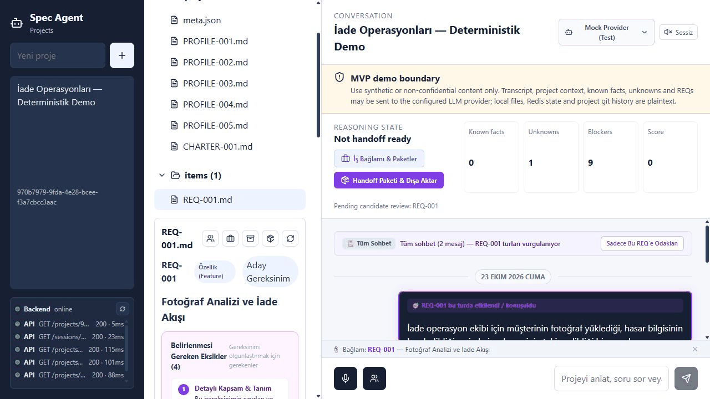
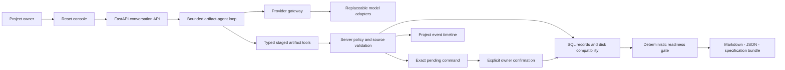
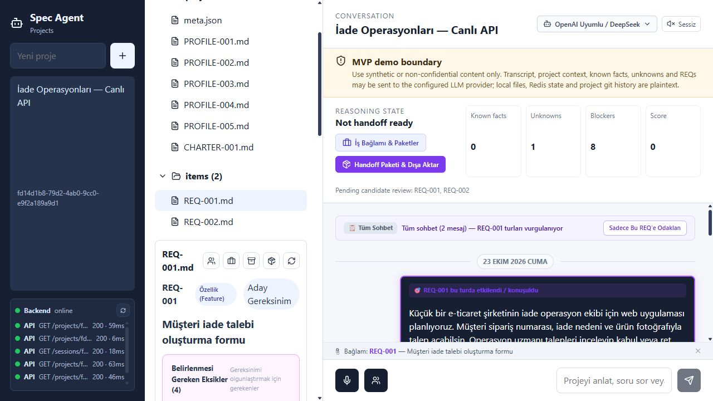
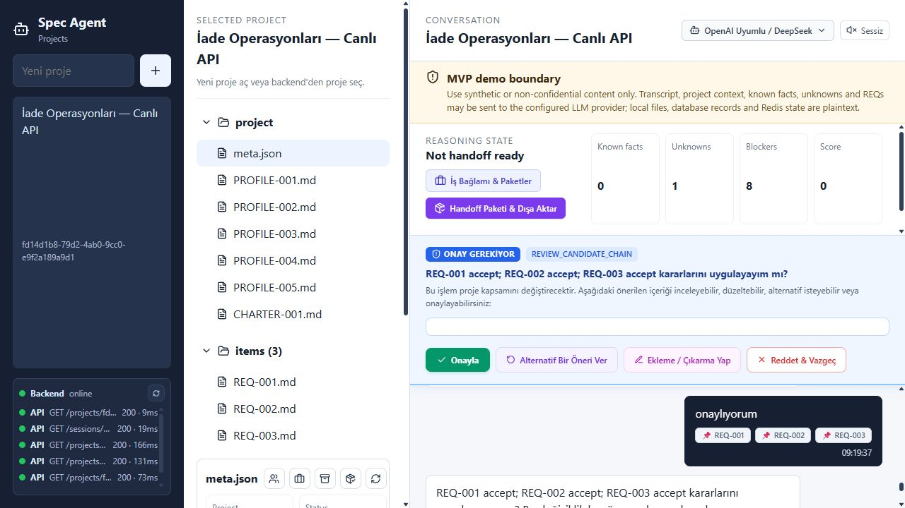
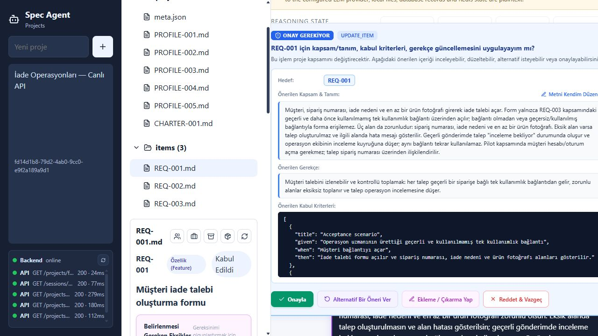
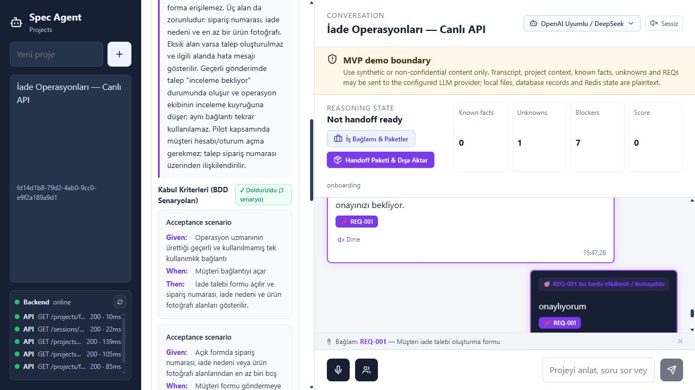
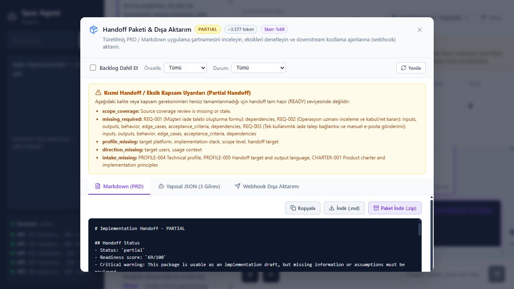
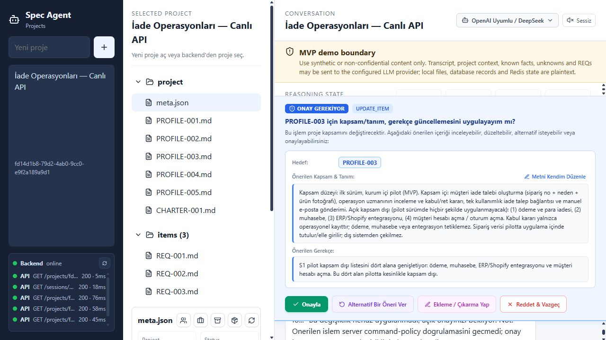
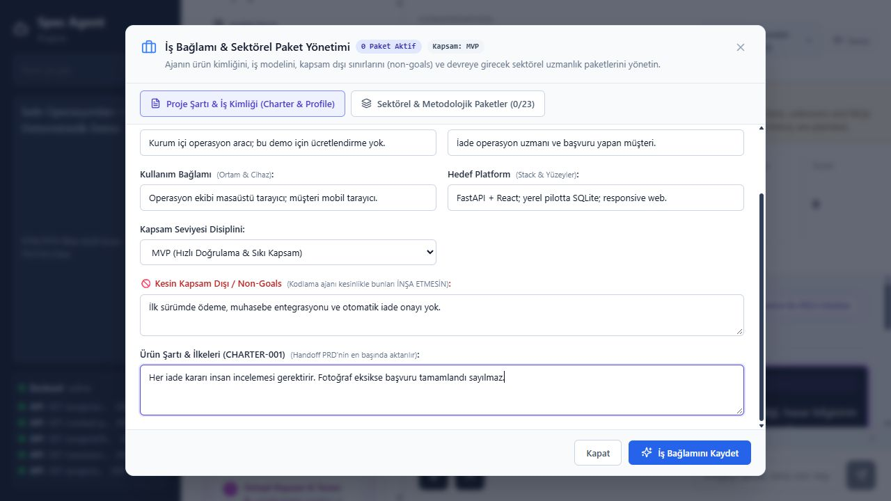
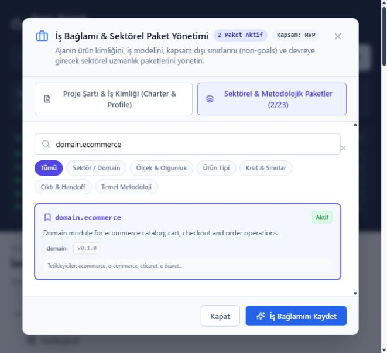

# Spec Agent


**Source-backed software discovery, governed scope decisions and inspectable implementation handoff.**

Formerly **Voice Spec Agent**. This repository is a portfolio case study with
browser captures and sanitized evidence. The application implementation remains
private; this repository does not contain an installable application.

## Table of Contents

1. [Overview](#overview)
2. [Key Features](#key-features)
3. [Processing Pipeline](#processing-pipeline)
4. [System Architecture](#system-architecture)
5. [Requirement Lifecycle](#requirement-lifecycle)
6. [Design Decisions](#design-decisions)
7. [Verification And Dogfood](#verification)
8. [Screenshots](#screenshots)
9. [Raw Evidence](#evidence)
10. [Current Limits](#limits)
11. [Türkçe Özet](#turkce-ozet)
12. [Author](#author)

---

<a name="overview"></a>

## Overview

Spec Agent helps a project owner turn an uncertain software idea into traceable
requirements through a coached conversation. It maintains **PROFILE** records for
project context, **CHARTER** for principles and boundaries, and **REQ** records for
implementation-sized capabilities.

The engineering problem is maintaining a reliable boundary between discussion,
candidate scope, accepted scope and implementation readiness. Model suggestions
are proposals. Server policy owns artifact changes, lifecycle transitions and
approval. Handoff documents are derived from recorded state and include warnings
when the project is incomplete.

The interface supports typed conversation, browser speech input, bounded batch
transcription, attributed meeting intake and browser-owned speech playback. The
requirements engine uses a shared transcript/turn path; voice is an input surface.



*A sequence of actual browser captures. Live-provider and deterministic views are
labelled separately below; this GIF is not a continuous screencast.*

<a name="key-features"></a>

## Key Features

| Area | Implemented behavior |
| --- | --- |
| Guided discovery | Discuss users, scope, exclusions, constraints and unresolved decisions. |
| Bounded artifact agent | Typed read/staging tools, tool-result continuations, one terminal action and explicit budgets. |
| Source provenance | Current user evidence is writable `S1`; context packs and model suggestions cannot prove user intent. |
| Candidate-first scope | Capture supported capabilities without silently accepting them into the implementation scope. |
| Reviewable approval | Inspect targets and payloads; UI decisions carry the exact reviewed command ID and refuse stale/replaced proposals. |
| Context packs | Select advisory domain, scale, platform, constraint and output guidance. |
| Requirement detailing | Record descriptions, rationale, dependencies and Given/When/Then acceptance criteria. |
| Readiness gate | Check required intake, unresolved decisions, requirement completeness and source-coverage freshness. |
| Handoff | Produce warning-visible Markdown, structured JSON and a specification bundle. |
| Traceability | Project conversation, observable agent stages, source links and revision history. |
| Model access | Central gateway with Gemini, OpenAI, Anthropic and OpenAI-compatible adapters; deterministic fake provider for tests. |
| Voice/meeting surfaces | Browser STT/TTS, bounded batch STT and attributed candidate extraction; live speech evidence is separate. |

<a name="processing-pipeline"></a>

## Processing Pipeline

1. Create/select a project and establish its profile, intended users and boundaries.
2. Submit text or a transcript through the canonical conversation route.
3. Load bounded canonical context and relevant advisory packs.
4. Let the model propose typed observations, candidate changes or one decision.
5. Validate source ownership, target identity, schema and lifecycle rules on the server.
6. Commit valid staged changes; queue protected changes for explicit confirmation.
7. Recompute readiness from persisted artifacts and recorded coverage evidence.
8. Inspect and export a handoff with remaining blockers and exclusions visible.

An accepted requirement is not automatically ready for implementation. An export
does not establish that every real-world requirement has been discovered.

<a name="system-architecture"></a>

## System Architecture



| Layer | Technology / responsibility |
| --- | --- |
| Console | React, TypeScript and Vite; conversation, artifacts, approvals and export inspection. |
| API | FastAPI and Pydantic; project/session guards, typed commands and controlled errors. |
| Agent | Server-owned staging and bounded native tool loop; model calls through one gateway. |
| Artifact persistence | Async SQLAlchemy; SQLite locally, PostgreSQL adapter support. |
| Compatibility files | Markdown/meta mirrors and disk read-through; not a completed SQL-only authority migration. |
| Transient sessions | Redis with a bounded in-process fallback; pending proposals expire and fallback does not survive restart. |
| Trace/revisions | Project events, conversation records and SQL revision/history records. |
| Readiness | Deterministic completeness and source-coverage checks over persisted state. |

The repaired artifact batch uses one SQL transaction and restores staged files on
in-process refusal/cancellation. This is not a crash-atomic transaction spanning
SQL and filesystem mirrors. Old Git-named history APIs are compatibility shims;
the current artifact revision store does not run Git subprocesses.

<a name="requirement-lifecycle"></a>

## Requirement Lifecycle

```text
candidate -> accepted -> in_detailing -> ready_for_handoff
     |           |             |                 |
     +-----------+-------------+-----------------+-> backlog / archived
backlog / archived -- explicit restore --> candidate
```

Candidates retain their source and remain outside accepted implementation scope.
Scope acceptance, archive/backlog and protected changes require reviewable approval.
PROFILE and CHARTER have their own evidence lifecycle.

Missing required intake, unresolved high-risk decisions, candidates, incomplete
requirements, dependency problems or missing/stale coverage review produce a
partial or blocked handoff. A model saying “ready” cannot override this gate.

<a name="design-decisions"></a>

## Design Decisions

| Decision | Reason | Tradeoff / boundary |
| --- | --- | --- |
| Artifacts as persistent project state | Continue discovery beyond one chat response. | More schema, revision and synchronization work. |
| Server-owned commands | Prevent model prose/tool arguments from directly authorizing scope changes. | Additional review states and explicit confirmation. |
| Current-source write boundary | Separate user intent from advisory context and generated suggestions. | Earlier knowledge must be resolved/referenced through governed context. |
| Bounded native tool loop | Let models read and stage useful changes through typed contracts. | Budget/contract failure must discard uncommitted staging. |
| Candidate before accepted scope | Capture ideas while preserving an explicit scope decision. | Discovery and acceptance are distinct interactions. |
| Deterministic handoff gate | Expose missing evidence instead of relying on persuasive prose. | Structural checks cannot guarantee semantic completeness. |
| Multi-provider gateway | Keep vendor details outside policy and storage. | Protocol/model support still needs provider-specific live verification. |
| Text-first voice compatibility | Share one requirements path across input surfaces. | Browser capabilities and batch STT differ from real-time duplex voice. |

ContextRail-style project memory separates the current system map, active work,
decisions and completion evidence. It helps maintain the private project; working
notes, private operator sessions and internal planning are not distributed here.

<a name="verification"></a>

## Verification And Dogfood

The October 23, 2026 review found defects after the previous completion claim.
The audit checks actual policy/storage boundaries and records repairs separately
from presentation work.

| Finding | Reproduction / resulting behavior |
| --- | --- |
| Partial SQL commit inside an artifact batch | A later rejected update left an earlier update committed while disk restoration concealed it. Updates now share the outer SQL session. Tests inspect SQL and disk directly. |
| Catalog failure became HTTP 500 | A configured-default fallback used invalid model metadata arguments. The API now identifies a degraded configured fallback and refuses unknown providers. |
| Protected intake proposal rejected | Internal quality metadata leaked into an editable command payload. Protected revisions now propose reviewed content fields while retaining server-owned quality state. |
| Stale approval could act on another proposal | An expired button sent ordinary chat text; replacement commands could be consumed. UI approval/rejection now carries the reviewed ID, checked under the turn lock before events, model calls or artifact writes. |
| Stored details appeared missing | JSON export returned frontmatter only. It now includes persisted descriptions, rationale, conditions and BDD while preserving compatibility metadata formats. |

The live dogfood uses **DeepSeek `deepseek-v4-flash` through the real gateway**
with synthetic return-operations requirements. Its recorded conversation and
artifact/handoff snapshots are inspectable below. Deterministic Mock Provider
screens are a separate fixture run, not live-model evidence.

The recorded run created **three candidates**, accepted them through an explicit
scope review, and approved an exact REQ-001 revision with **three BDD scenarios**.
Other artifacts remained unchanged by that revision. Replaying the consumed
command returned **HTTP 409** without artifact, conversation or history changes.
The actual handoff is **PARTIAL, 69/100**: missing intake, requirement dimensions
and stale/missing source-coverage review remain visible. This sample stops before
full discovery; no READY state was manufactured for the showcase.

The complete private backend run reported **499 passed, 5 live tests deselected**;
the separate browser-mock suite reported **6 passed**, and the frontend built.
The live browser session above is separate evidence from those automated tests.

Private-suite results are maintainer-reported snapshots in [audit.json](evidence/audit.json).
The private source and full test suite are not distributed here. Tests establish
specific behavior, not complete product correctness or production readiness.

<a name="screenshots"></a>

## Screenshots

### Live API Discovery



### Explicit Scope Review



### Protected Content Revision





### Honest Handoff Readiness



### Earlier Profile Proposal



*This particular profile proposal expired before confirmation. The later approved
revision above targets REQ-001; the two are not interchangeable evidence.*

### Deterministic Fixture Before The Projection Repair


*An earlier Mock Provider capture. Missing fields in that view include the JSON
projection defect repaired during the audit; see the live final view above.*

### Business Context And Non-Goals



### Advisory Context Selection



<a name="evidence"></a>

## Raw Evidence

| File | Purpose |
| --- | --- |
| [live-workflow.json](evidence/live-workflow.json) | Observed live scenario, checkpoints and evidence boundaries. |
| [live-conversation.json](evidence/live-conversation.json) | Synthetic user/model conversation and observable provider/agent events. |
| [artifacts.json](evidence/artifacts.json) | Actual final project artifact snapshot. |
| [approval-checkpoints.json](evidence/approval-checkpoints.json) | Before/after scope and content decisions plus consumed-command refusal. |
| [handoff.md](evidence/handoff.md) | Actual generated handoff with its readiness warnings. |
| [handoff.json](evidence/handoff.json) | The same handoff as structured tasks, intake status and blockers. |
| [audit.json](evidence/audit.json) | Dated audit, negative controls and private-suite/build results. |
| [manifest.json](evidence/manifest.json) | Artifact and screenshot/GIF SHA-256 hashes; excludes itself. |

Only synthetic scenario data is shared. No API keys, native credentials, personal
project data, private implementation or raw development memory is included.
Hashes establish consistency of the shared bytes, not independently authenticated
provenance or semantic correctness.

<a name="limits"></a>

## Current Limits

- Local engineering PoC; no hosted self-service, multi-tenant production or compliance claim.
- The deterministic gate cannot prove that requirements are semantically exhaustive.
- Database records, disk compatibility reads, event files and transient session state
  do not form one durable transaction; crash/multi-process consistency needs separate work.
- Redis fallback is volatile; durable artifacts and recorded conversation are distinct
  from pending-command/session survival. Restart recovery must not invent approval.
- Voice UI and automated browser-mock checks do not prove real microphone/STT/TTS
  quality. Server-owned production duplex voice is not claimed.
- Configured model metadata is not availability, entitlement or quota proof.
- Operator-entered webhook targets can cause outbound requests. Public/untrusted
  exposure requires separate network/authentication hardening.
- This repository cannot install or independently audit the private application.

---

<a name="turkce-ozet"></a>

# Türkçe Özet

## Amaç ve Çalışma Akışı

**Spec Agent**, önceki adıyla Voice Spec Agent, yazılım fikirlerini sohbet üzerinden
netleştirip kaynak izli gereksinimlere dönüştüren bir mühendislik PoC’sidir. Proje
profili, kapsam sınırları ve gereksinimler kalıcı artifact olarak tutulur. Kullanıcı
adayları inceler, kapsam kararlarını onaylar ve kodlama ekibine aktarılacak çıktıyı görür.

Ajanın önerisi doğrudan yetki sayılmaz. Sunucu; kaynak, hedef, şema ve yaşam döngüsü
kontrollerini uygular. Aday gereksinim, kabul edilmiş kapsam ve handoff’a hazırlık
ayrı durumlardır. Eksikler varsa çıktı bunları görünür tutar.

## Mimari ve Kanıt

React konsolun arkasında FastAPI, sınırlı artifact-agent döngüsü, merkezi model
gateway’i, SQL kayıtları ve dosya uyumluluk katmanı vardır. Ses veya toplantı
deşifresi aynı gereksinim akışına girdi sağlar. Tam gerçek zamanlı sesli görüşme
ve üretim düzeyi çok kullanıcılı hizmet bu vitrinin iddiası değildir.

23 Ekim audit’inde toplu işlem atomikliği ve model listesi hata yolu dahil gerçek
sorunlar bulundu ve davranış testleriyle düzeltildi. Canlı DeepSeek denemesi ile
ayrı deterministik demo birbirinden ayrılmıştır. Ekranlar gerçek tarayıcı
kayıtlarıdır; konuşma, artifact, handoff ve doğrulama kayıtları yukarıda açıktır.

Canlı turda üç aday açık onayla kapsama alındı; bir gereksinimin üç BDD senaryosu
incelenip kaydedildi. Eski onayın yeniden gönderilmesi değişiklik yapmadan
reddedildi. Son backend koşusunda 499, ayrı tarayıcı mock koşusunda 6 test geçti.
Örnek handoff 69/100 puanla **PARTIAL** kaldı; eksikleri gizlemeden gösterir.

## Mevcut Durum

Bu repo teknik vitrindir; uygulama kaynağı private kalır. Başarılı bir örnek ve
geçen testler, gereksinimlerin eksiksiz keşfedildiğini veya ürünün production’a
hazır olduğunu kanıtlamaz. Bilinen sınırlar İngilizce ana anlatımda korunur.

---

<a name="author"></a>

## Author

**Muhammet Işık**

[](https://github.com/muisik)
[](https://linkedin.com/in/muisik)
